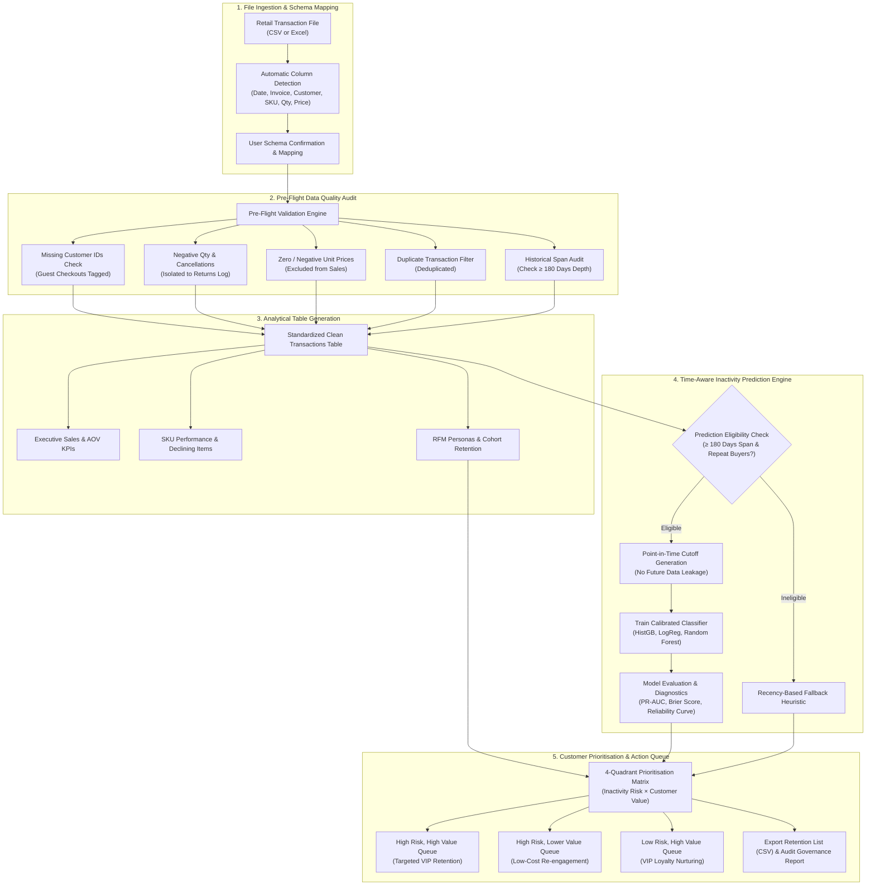
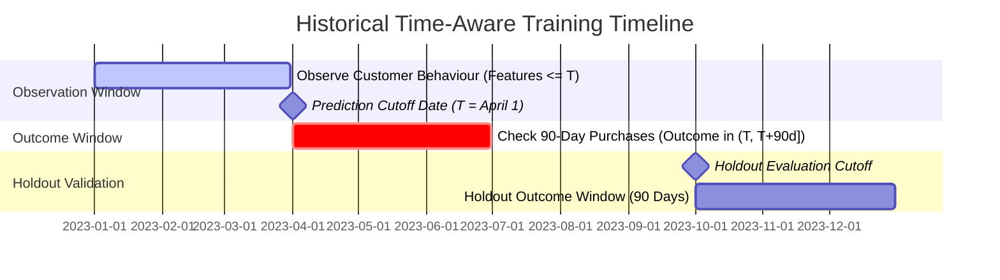
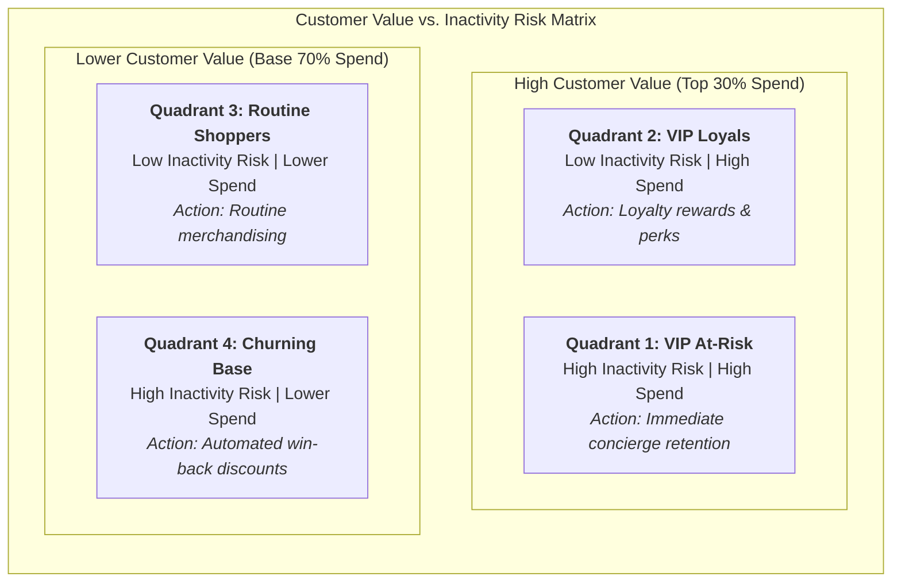

# RetailIQ — Business & Customer Intelligence Platform

[](https://www.python.org/downloads/release/python-3110/)
[](tests/)
[](https://dash.plotly.com)
[](https://dash-mantine-components.com)
[](https://scikit-learn.org)
[](https://github.com/astral-sh/ruff)
[](LICENSE)

**RetailIQ** is an enterprise-grade, file-upload-driven retail intelligence and customer prediction platform powered by **Plotly Dash** and **Dash Mantine Components (`dash-mantine-components`)**. A business user uploads historical transaction data (CSV or Excel) at any time to automatically generate executive analytics, product momentum diagnostics, RFM behavioral personas, calibrated 90-day inactivity predictions, and a prioritized customer retention intervention queue.

---

## System Workflow & Architecture

The application guides the merchant through an automated, quality-governed analytical pipeline:



---

## Point-in-Time Prediction Architecture (Zero Data Leakage)

RetailIQ frames the prediction target specifically for non-subscription commerce:

$$\text{Inactivity}_{90d} = \begin{cases} 1 & \text{if customer makes 0 qualifying purchases in next 90 days} \\ 0 & \text{if customer makes } \ge 1 \text{ qualifying purchase in next 90 days} \end{cases}$$

To prevent **temporal data leakage**, training features are strictly computed from transactions occurring on or before historical cutoff date $T$, while customer labels are observed exclusively during the subsequent 90-day outcome window:



---

## Actionable 4-Quadrant Customer Prioritisation

A prediction alone is not enough to guide business action. RetailIQ blends predicted inactivity risk with customer monetary spend into an actionable intervention queue:



| Priority Quadrant | Strategic Recommendation | Action Mechanism |
|---|---|---|
| **High Risk, High Value** | **Review first for targeted retention campaign** | High-touch VIP concierge outreach, personalized incentives, manager follow-up |
| **High Risk, Lower Value** | **Consider lower-cost automated re-engagement** | Automated marketing emails, win-back coupons, cart reminders |
| **Low Risk, High Value** | **Focus on loyalty rewards and repeat purchases** | Exclusive previews, loyalty tier upgrades, upsell and cross-sell bundles |
| **Low Risk, Lower Value** | **Continue routine monitoring** | Standard newsletter inclusion and routine merchandising |

---

## Interactive Application Modules

The platform features 7 dedicated analytical and diagnostic tabs built with Plotly Dash and Dash Mantine Components:

### 1. Data Ingestion & Quality Audit
Drag-and-drop CSV or Excel uploads, automatic column mapping detection, and pre-flight quality verification (negative quantities, refund tracking, guest checkouts, and historical depth audit).

### 2. Executive Overview
Macro sales KPIs (Gross Revenue, Net Revenue, Orders, AOV, Return Rate), interval-selectable time series sales trajectory (Daily, Weekly, Monthly), day-of-week sales volume distribution, and top revenue drivers.

### 3. Product & Geographic Intelligence
SKU volume and revenue rankings, declining demand anomaly detection (comparing early vs. recent periods), country market share distribution, and high-return items audit.

### 4. Customer Behaviour & RFM Personas
Quantile-based RFM scoring across 11 actionable personas (Champions, Loyal Customers, At-Risk, etc.), purchase frequency histograms, recency distribution curves, and monthly acquisition cohort retention heatmaps.

### 5. Inactivity Prediction & Model Diagnostics
Temporal eligibility verification, point-in-time model training (HistGradientBoosting, Random Forest, Logistic Regression), probability calibration via `CalibratedClassifierCV`, calibration reliability diagrams, Precision-Recall curves (PR-AUC vs. naive baseline), and key predictive feature weights.

### 6. Actionable Customer Prioritisation
Interactive 2x2 Risk vs. Value scatter matrix with boundary crosshairs, 4-quadrant intervention queues (VIP At-Risk, Churning Base, VIP Loyals, Routine Shoppers), configurable priority ranking formula sliders, customer inspector, and 1-click CSV queue export.

### 7. Data & Model Governance Report
Comprehensive audit scorecard of records ingested and retained, exclusions and refund breakdown, model hyperparameters and evaluation metrics, operational assumptions, and downloadable Markdown/JSON audit logs.

---

## Independent Prediction Policy

RetailIQ enforces a strict prediction governance framework to avoid presenting untrustworthy scores:

| Uploaded Data Situation | Application Behaviour |
|---|---|
| **Sufficient history (&ge; 180 days) and usable outcomes** | Partitions historical cutoffs, trains a business-specific calibrated model, verifies PR-AUC & Brier score, and scores active customers |
| **Sufficient sales data but short time depth (< 180 days)** | Presents complete executive analytics and RFM segmentation; utilizes transparent recency fallback heuristics and clearly flags scores as unvalidated |
| **Incompatible columns or ambiguous transaction records** | Alerts user during Step 2 schema mapping and Step 3 pre-flight validation before executing analytics |
| **Benchmark / Demonstration Mode** | Provides 1-click access to an 18-month retail dataset (8,910 records) for full capability exploration |

---

## Quick Start

### 1. Prerequisites
- Python 3.10, 3.11, or 3.12
- Windows, macOS, or Linux

### 2. Setup Virtual Environment

```bash
# Windows (PowerShell)
python -m venv .venv
.\.venv\Scripts\Activate.ps1

# Linux / macOS
python3 -m venv .venv
source .venv/bin/activate
```

### 3. Install Dependencies

```bash
pip install -r requirements.txt
```

### 4. Generate Benchmark Dataset & Train Model

```bash
python scripts/build_benchmark.py
python scripts/train_model.py
```

### 5. Run Automated Tests

```bash
pytest -v
```

### 6. Launch Application

```bash
python dash_app.py
```

Navigate to `http://127.0.0.1:8050` in your web browser. The application features an enterprise SaaS interface built with Plotly Dash and Dash Mantine Components, zero emojis, and reactive analytical tabs.

---

## Project Structure

```
RetailIQ — Business & Customer Intelligence Platform/
├── dash_app.py                          # Primary Plotly Dash + Mantine enterprise entrypoint
├── src/retail_intelligence/
│   ├── dash_state.py                    # Singleton reactive state controller for Dash
│   ├── dash_ui/                         # Dash Mantine Components view modules (Zero Emojis)
│   │   ├── header.py                    # Enterprise brand navbar & telemetry badge
│   │   ├── view_ingestion.py            # Drag-and-drop upload & pre-flight audit
│   │   ├── view_executive.py            # Top KPIs, sales trends, day-of-week & bestsellers
│   │   ├── view_product.py              # SKU ranking, declining alert, country distribution
│   │   ├── view_customer.py             # RFM personas, behavioral histograms, cohorts
│   │   ├── view_prediction.py           # Model training, calibration curve & PR curve
│   │   ├── view_prioritisation.py       # 4-Quadrant matrix, scatter plot & CSV queue
│   │   └── view_report.py               # Governance audit scorecard, Markdown & JSON export
│   ├── ingestion.py                     # CSV/Excel parsing, inspection, encoding fallback
│   ├── schema_mapping.py                # Heuristic column detection & mapping validation
│   ├── validation.py                    # Pre-flight data quality checks & issue tagging
│   ├── cleaning.py                      # Returns separation, guest tagging, deduplication
│   ├── metrics.py                       # Analytical KPI queries, sales trends, cohorts
│   ├── customer_features.py             # Point-in-time leakage-free customer features
│   ├── segmentation.py                  # Quantile RFM scoring & segment personas
│   ├── labels.py                        # Temporal cutoffs & 90-day binary inactivity labels
│   ├── training.py                      # Calibrated ML pipelines (HistGB, LogReg, RF)
│   ├── evaluation.py                    # PR-AUC, ROC-AUC, Brier score, reliability verdicts
│   ├── prediction.py                    # Current customer scoring & heuristic fallback
│   ├── prioritisation.py                # 4-Quadrant matrix & composite priority scores
│   └── reporting.py                     # Audit logs, markdown scorecards & JSON exports
├── scripts/
│   ├── build_benchmark.py               # Generates 18-month UCI-style synthetic dataset
│   ├── download_data.py                 # UCI dataset provisioner
│   └── train_model.py                   # Standalone CLI training and evaluation pipeline
├── data/raw/
│   ├── online_retail_sample.csv         # 8,910 benchmark records (ready for 1-click test)
│   └── online_retail_sample.xlsx        # Excel format benchmark
├── models/
│   └── inactivity_model_latest.pkl      # Calibrated production-ready model artifact
├── tests/                               # Comprehensive unit test suite (14 passing tests)
├── requirements.txt
├── pyproject.toml
└── README.md
```

---

## Quality & Test Coverage

The test suite validates every pipeline stage:
- Schema mapping heuristics and duplicate column collision handling
- Pre-flight validation error triggers (unparseable dates, negative prices, missing customer IDs)
- Data cleaning standardisation, returns separation, and duplicate elimination
- Point-in-time customer feature computation with verified zero future data leakage
- Quantile-based RFM scoring and persona categorisation
- Temporal 90-day binary inactivity label creation
- Probability-calibrated classifier fitting and PR-AUC / Brier score evaluation
- 4-Quadrant customer prioritisation ranking and composite scoring

Run all tests:
```bash
pytest -v
```

---

## License

This project is licensed under the MIT License - free for commercial, internal, and academic use.
