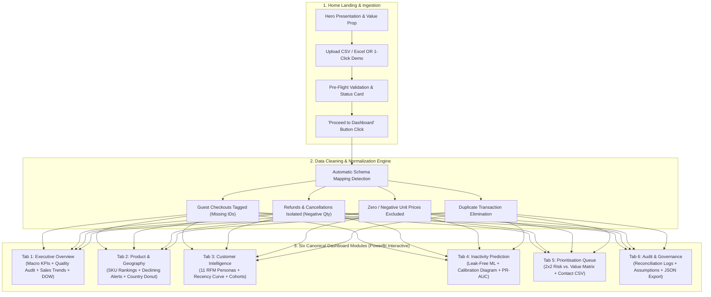
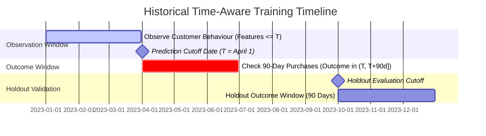
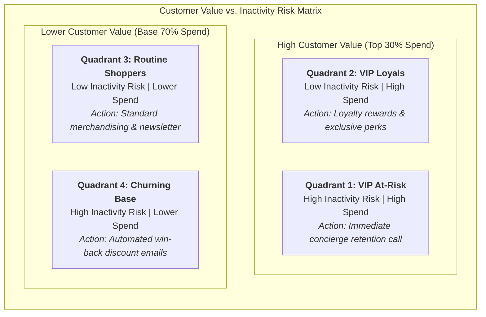

# RetailIQ — Business & Customer Intelligence Platform

[](https://www.python.org/downloads/release/python-3110/)
[](tests/)
[](https://dash.plotly.com)
[](https://dash-mantine-components.com)
[](https://scikit-learn.org)
[](https://github.com/astral-sh/ruff)
[](LICENSE)

**RetailIQ** is an enterprise-grade retail intelligence and customer prediction platform powered by **Plotly Dash** and **Dash Mantine Components (`dash-mantine-components`)**. Designed for founders, e-commerce managers, and analysts, RetailIQ transforms raw transaction data (CSV or Excel) into executive KPIs, product momentum diagnostics, RFM behavioral personas, calibrated 90-day inactivity predictions, and a prioritized VIP retention queue with **PowerBI-style interactive cross-filtering**.

---

## Key Features & Highlights

- **Modern Home Landing Page:** Welcoming hero section, platform feature breakdown, drag-and-drop CSV/Excel ingestion, and a 1-click demo benchmark dataset (8,910 records) with smart guard prompts.
- **PowerBI-Style Interactive Cross-Filtering:** Touching or clicking any bar, pie slice, or scatter point dynamically filters the entire page (macro KPIs, dependent charts, anomaly alerts, and contact tables), complete with dedicated reset buttons on every plot card.
- **Seamless Light & Dark Mode:** Global header theme toggle with custom high-contrast typography ensuring all chart text, axes, product names, and legends remain crisp and readable in dark mode.
- **Calibrated Point-in-Time Machine Learning:** 100% leak-free historical cutoff training using `CalibratedClassifierCV` (HistGradientBoosting, Random Forest, Logistic Regression) predicting 90-day customer inactivity.
- **4-Quadrant Action Prioritization:** Combines predicted churn risk with customer lifetime spend into high-touch VIP retention, automated win-back, and loyalty queues with 1-click CSV export.
- **Audit & Governance Scorecard:** Pre-flight data quality validation, refund tracking, guest checkout isolation, and downloadable Markdown/JSON audit logs.

---

## System Architecture & End-to-End Workflow



---

## PowerBI-Style Interactive Cross-Filtering

RetailIQ features dynamic, bidirectional cross-filtering across its primary analytical views:

```
 ┌──────────────────────┐      Click / Touch Bar or Slice      ┌───────────────────────────┐
 │ Interactive Chart    │ ───────────────────────────────────► │ Entire Page Updates:      │
 │ (Selected = Vivid,   │                                      │ • Macro KPI Cards         │
 │  Unselected = Dimmed)│ ◄─────────────────────────────────── │ • Dependent Breakdowns    │
 └──────────────────────┘      Click Reset Button (or toggle)  │ • Data & Ranking Tables   │
                                                               └───────────────────────────┘
```

1. **Executive Overview:** Click any Day-of-Week bar (e.g., *Friday*) to highlight that day in bold blue, dim others, and cross-filter the 5 macro KPI cards, revenue trend interval, and top products table. Each chart header includes a dedicated reset button (`Rotate-2` icon) to instantly clear the filter.
2. **Product & Geography:** Click any country slice in the geographic donut to pull out the slice in 3D and cross-filter the top products chart, declining demand alerts, and return rate tables to that country.
3. **Customer Intelligence:** Click any RFM persona bar (e.g., *Champions*, *At Risk*) to re-compute customer KPIs, re-segment the recency curve, and highlight that persona in the scorecard table.
4. **Prioritisation Matrix:** Click any customer point or quadrant in the 2x2 scatter matrix to filter the actionable contact queue table for immediate outreach.

---

## Point-in-Time Prediction Architecture (Zero Data Leakage)

RetailIQ frames the prediction target specifically for non-contractual retail:

$$\text{Inactivity}_{90d} = \begin{cases} 1 & \text{if customer makes 0 qualifying purchases in next 90 days} \\ 0 & \text{if customer makes } \ge 1 \text{ qualifying purchase in next 90 days} \end{cases}$$

To eliminate **temporal data leakage**, training features are strictly computed from transactions occurring on or before historical cutoff date $T$, while customer labels are observed exclusively during the subsequent 90-day outcome window:



---

## Actionable 4-Quadrant Customer Prioritisation

A prediction score alone is insufficient for commercial decision-making. RetailIQ blends predicted inactivity risk with customer monetary spend into an actionable intervention queue:



| Priority Quadrant | Strategic Recommendation | Action Mechanism |
|---|---|---|
| **High Risk, High Value** | **Review first for targeted retention campaign** | High-touch VIP concierge outreach, personalized incentives, account manager follow-up |
| **High Risk, Lower Value** | **Consider lower-cost automated re-engagement** | Automated marketing workflows, win-back coupons, cart recovery |
| **Low Risk, High Value** | **Focus on loyalty rewards and repeat purchases** | Exclusive previews, loyalty tier upgrades, cross-sell bundles |
| **Low Risk, Lower Value** | **Continue routine monitoring** | Standard newsletter inclusion and organic merchandising |

---

## The 6 Canonical Dashboard Modules

### 1. Executive Overview
- **Macro KPI Cards:** Gross Revenue, Net Revenue, Returns Revenue, Total Orders, Unique Registered Customers, Guest Orders, Average Order Value (AOV), Units per Order, and Return Rate %.
- **Data Quality & Reconciliation Scorecard:** Ingested vs. clean transactions, refunds isolated, duplicates removed, and guest checkout ratio.
- **Sales Trend Analysis:** Dual-axis interactive line and bar chart (Revenue vs. Orders) with Daily (`D`), Weekly (`W`), and Monthly (`M`) intervals.
- **Day-of-Week Distribution:** Sales volume patterns across Monday through Sunday.
- **Top Products Snapshot:** Fast preview of top-performing items.

### 2. Product & Geographic Intelligence
- **SKU Rankings:** Sortable item-level performance by gross sales dollars or physical volume.
- **Declining Demand Anomaly Detection:** Early-half vs. recent-half revenue comparisons identifying products experiencing >40% drops.
- **Geographic Revenue Distribution:** 3D interactive country donut chart with clickable cross-filtering.
- **Product Return Rates:** High-return items breakdown highlighting products driving excessive refunds.

### 3. Customer Intelligence & RFM Personas
- **11-Persona RFM Categorisation:** Quantile-based customer scoring into actionable archetypes (*Champions*, *Loyal*, *Potential Loyalists*, *At Risk*, *Can't Lose Them*, *Hibernating*, etc.).
- **Behavioral Histograms:** Customer recency distribution and transaction frequency histograms.
- **Monthly Cohort Retention Heatmap:** Visualizes multi-month customer retention decay by acquisition cohort.

### 4. Inactivity Prediction & Model Diagnostics
- **Temporal Eligibility Verification:** Automatically audits historical span (&ge; 180 days) and minimum buyer thresholds.
- **Three Estimators:** Histogram Gradient Boosting (`HistGradientBoostingClassifier`), Random Forest (`RandomForestClassifier`), and Logistic Regression (`LogisticRegression`).
- **Probability Calibration:** 3-fold cross-validated `CalibratedClassifierCV` guaranteeing predicted percentages match real-world frequencies.
- **Model Diagnostics:** Reliability curve (calibration diagram), Precision-Recall curve vs. naive baseline, and feature importance rankings.

### 5. Actionable Customer Prioritisation Queue
- **Interactive 2x2 Scatter Matrix:** Customers plotted by Inactivity Risk (X-axis) vs. Total Spend (Y-axis) with draggable boundary cutoffs.
- **Tunable Urgency Formula:** Adjustable weights balancing Inactivity Probability and Monetary Spend into a composite 0-100 Priority Score.
- **Actionable Contact Queue:** Sortable table displaying Customer ID, Phone/Email tag, RFM Persona, Churn Risk, Total Spend, and Priority Group.
- **1-Click Export:** Download clean CSV contact queues for direct upload to Klaviyo, Mailchimp, or CRM.

### 6. Audit & Governance Report
- **Data Reconciliation Scorecard:** Ingested records, clean sales rows, returns extracted, duplicates dropped, and guest ratios.
- **Model Governance Summary:** Estimator parameters, calibration method, validation metrics, and production reliability verdict.
- **Documented Operational Assumptions:** Transparent documentation of model limitations and retail boundaries.
- **1-Click Audit Download:** Export complete audit reports in Markdown (`.md`) and JSON formats.

---

## Quick Start

### 1. Prerequisites
- Python 3.10, 3.11, or 3.12
- Windows, macOS, or Linux

### 2. Setup Virtual Environment

```bash
# Windows (PowerShell)
python -m venv .venv
.\.venv\Scripts\Activate.ps1

# Linux / macOS
python3 -m venv .venv
source .venv/bin/activate
```

### 3. Install Dependencies

```bash
pip install -r requirements.txt
pip install -e .
```

### 4. Run Automated Test Suite (31 Tests)

```bash
pytest -v
```

### 5. Launch RetailIQ Application

```bash
python dash_app.py
```

Open your browser and navigate to **`http://127.0.0.1:8050`**.

---

## Project Structure

```
RetailIQ — Business & Customer Intelligence Platform/
├── dash_app.py                                     # Primary Plotly Dash + Mantine application entrypoint
├── assets/
│   └── dashboard_tabs.css                          # Modern animated tabs and dark-mode high-contrast plot styles
├── src/retail_intelligence/
│   ├── dash_state.py                               # Reactive singleton state container
│   ├── dash_ui/                                    # UI view components (Zero Emojis, Mantine v7)
│   │   ├── header.py                               # Global navbar, navigation links & dark mode toggle
│   │   ├── view_landing.py                         # Home landing page: hero, features, upload & demo
│   │   ├── view_executive.py                       # Executive overview, macro KPIs & sales trends
│   │   ├── view_product.py                         # SKU rankings, country donut & declining alerts
│   │   ├── view_customer.py                        # RFM personas, recency distribution & cohorts
│   │   ├── view_prediction.py                      # Calibrated ML training, reliability & PR curves
│   │   ├── view_prioritisation.py                  # 4-Quadrant scatter matrix & contact queue
│   │   ├── view_report.py                          # Governance scorecard, Markdown & JSON export
│   │   └── view_ingestion.py                       # Standalone ingestion and pre-flight audit
│   ├── ingestion.py                                # CSV/Excel parsing, encoding fallback & inspection
│   ├── schema_mapping.py                           # Heuristic column detection & validation
│   ├── validation.py                               # Pre-flight data quality checks & issue tagging
│   ├── cleaning.py                                 # Returns separation, guest tagging, deduplication
│   ├── metrics.py                                  # Store KPIs, sales trends, cohorts & country stats
│   ├── customer_features.py                        # Point-in-time leakage-free customer features
│   ├── segmentation.py                             # Quantile RFM scoring & segment personas
│   ├── labels.py                                   # Temporal cutoffs & 90-day binary inactivity labels
│   ├── training.py                                 # Calibrated ML pipelines (HistGB, LogReg, RF)
│   ├── evaluation.py                               # PR-AUC, ROC-AUC, Brier score, reliability verdicts
│   ├── prediction.py                               # Current customer scoring & heuristic fallback
│   ├── prioritisation.py                           # 4-Quadrant matrix & composite priority scores
│   └── reporting.py                                # Audit logs, markdown scorecards & JSON exports
├── scripts/
│   ├── build_benchmark.py                          # Generates 18-month UCI-style synthetic dataset
│   ├── download_data.py                            # UCI dataset provisioner
│   └── train_model.py                              # Standalone CLI training pipeline
├── data/raw/
│   ├── online_retail_sample.csv                    # 8,910 benchmark records (ready for 1-click test)
│   └── online_retail_sample.xlsx                   # Excel format benchmark
├── models/
│   └── inactivity_model_latest.pkl                 # Calibrated production-ready model artifact
├── tests/                                          # Unit tests (31 passing tests)
│   ├── test_cleaning.py
│   ├── test_features_and_rfm.py
│   ├── test_labels_and_training.py
│   ├── test_metrics.py
│   ├── test_prioritisation.py
│   ├── test_schema_mapping.py
│   ├── test_ui_flow.py                             # Full UI navigation, guard modal, and cross-filtering tests
│   └── test_validation.py
├── requirements.txt
├── pyproject.toml
├── RETAILIQ_MASTER_BUSINESS_AND_TECHNICAL_GUIDE.md  # Comprehensive 600+ line master reference manual
└── README.md
```

---

## Quality & Test Coverage

The test suite validates every pipeline stage:
- **UI Flow & Cross-Filtering:** Guard modal activation on empty data, demo dataset loading, Proceed button visibility, dark mode toggle, and PowerBI interactive chart filtering.
- **Schema Mapping & Ingestion:** Automatic column header heuristics, duplicate column collisions, and encoding fallbacks.
- **Pre-Flight Validation:** Missing customer ID tagging (guests), refund isolation, negative price exclusions, and historical depth checks.
- **Data Cleaning & Standardization:** Clean transaction filtering, returns segregation, and deduplication.
- **Customer Feature Engineering:** Point-in-time calculation with verified zero future data leakage.
- **Segmentation & Personas:** 5-bin quantile RFM scoring and 11-archetype persona assignment.
- **Predictive ML & Calibration:** 90-day inactivity labeling, classifier training, calibration reliability, PR-AUC, and Brier score evaluation.
- **Prioritization Queue:** 4-quadrant classification and composite priority scoring.

Execute the test suite:
```bash
pytest -v
# 31 passed in 3.08s
```

---

## License

This project is licensed under the MIT License - free for commercial, internal, and academic use.
