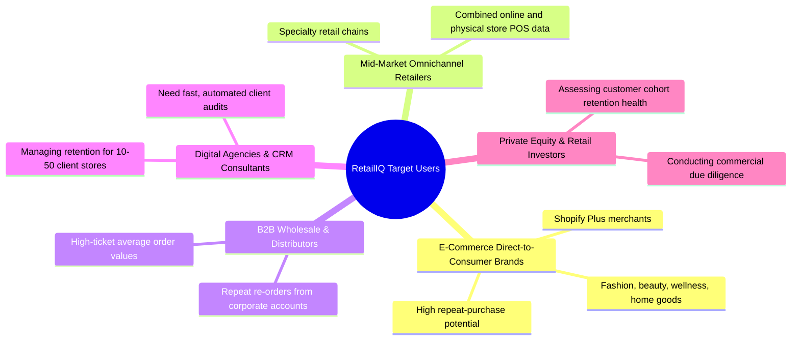
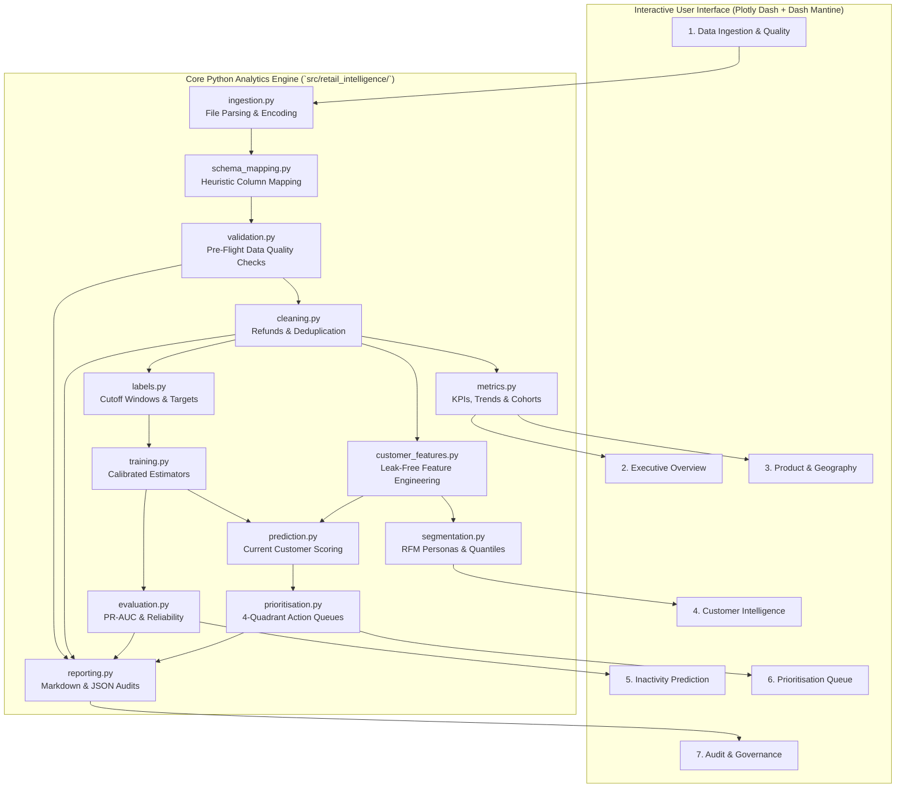
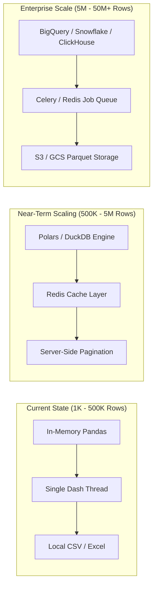

# RetailIQ: Comprehensive Business, Architecture, and Technical Master Guide

> **Document Type:** Master Business & Technical Specification / Knowledge Base  
> **Target Audience:** Founders, Product Managers, Data Scientists, Software Engineers, and Beginners to Business & Retail Concepts  
> **Platform Version:** RetailIQ v1.0 Enterprise  
> **Tech Stack:** Python 3.11+, Plotly Dash, Dash Mantine Components (`dash-mantine-components`), Scikit-Learn, Pandas, NumPy, Plotly Graph Objects

---

## Table of Contents

1. [Executive Summary & Elevator Pitch](#1-executive-summary--elevator-pitch)
2. [The "What": What is RetailIQ?](#2-the-what-what-is-retailiq)
3. [The "Why": Why Does RetailIQ Exist? (The Core Business Problem)](#3-the-why-why-does-retailiq-exist-the-core-business-problem)
4. [Who Are the Target Customers? (Market & User Personas)](#4-who-are-the-target-customers-market--user-personas)
5. [Business & Retail Concepts 101: The Beginner's Dictionary](#5-business--retail-concepts-101-the-beginners-dictionary)
   - [5.1 Revenue Metrics: Gross, Net, and Return Value](#51-revenue-metrics-gross-net-and-return-value)
   - [5.2 Order Dynamics: AOV and Units Per Order](#52-order-dynamics-aov-and-units-per-order)
   - [5.3 Customer Lifecycle: Active vs. Lapsed vs. Churned](#53-customer-lifecycle-active-vs-lapsed-vs-churned)
   - [5.4 The Critical Distinction: Contractual vs. Non-Contractual Churn](#54-the-critical-distinction-contractual-vs-non-contractual-churn)
   - [5.5 RFM Analysis & Quantile Scoring](#55-rfm-analysis--quantile-scoring)
   - [5.6 Cohort Retention Analysis (The "Retention Triangle")](#56-cohort-retention-analysis-the-retention-triangle)
   - [5.7 Probability Calibration (Why Raw Probabilities Lie)](#57-probability-calibration-why-raw-probabilities-lie)
   - [5.8 Model Evaluation Made Simple: PR-AUC, ROC-AUC, Brier Score](#58-model-evaluation-made-simple-pr-auc-roc-auc-brier-score)
   - [5.9 The 4-Quadrant Prioritization Framework](#59-the-4-quadrant-prioritization-framework)
6. [System Architecture & End-to-End Workflow](#6-system-architecture--end-to-end-workflow)
7. [Deep Dive: The 7 Core Platform Modules](#7-deep-dive-the-7-core-platform-modules)
   - [Module 1: Data Ingestion & Pre-Flight Quality Audit](#module-1-data-ingestion--pre-flight-quality-audit)
   - [Module 2: Executive Overview](#module-2-executive-overview)
   - [Module 3: Product & Geographic Intelligence](#module-3-product--geographic-intelligence)
   - [Module 4: Customer Intelligence & RFM Personas](#module-4-customer-intelligence--rfm-personas)
   - [Module 5: Inactivity Prediction & Model Diagnostics](#module-5-inactivity-prediction--model-diagnostics)
   - [Module 6: Actionable Customer Prioritisation Queue](#module-6-actionable-customer-prioritisation-queue)
   - [Module 7: Data & Model Governance Report](#module-7-data--model-governance-report)
8. [The Machine Learning Foundation: Point-in-Time Prediction](#8-the-machine-learning-foundation-point-in-time-prediction)
9. [Pros and Cons of RetailIQ](#9-pros-and-cons-of-retailiq)
10. [Strategic & Technical Trade-offs](#10-strategic--technical-trade-offs)
11. [Scalability Analysis & Production Bottlenecks](#11-scalability-analysis--production-bottlenecks)
12. [Future Enhancements & Product Roadmap](#12-future-enhancements--product-roadmap)
13. [How to Pitch and Present This Project](#13-how-to-pitch-and-present-this-project)

---

## 1. Executive Summary & Elevator Pitch

### The 30-Second Elevator Pitch
> *"Most e-commerce merchants lose up to 30% of their annual revenue simply because they realize a top customer stopped buying three months too late. **RetailIQ** is an enterprise-grade retail intelligence platform that turns raw transaction receipts into calibrated 90-day inactivity predictions and prioritized VIP retention queues. Instead of looking only at what happened yesterday, RetailIQ enables merchants to proactively protect high-value customer relationships before they walk away."*

### What RetailIQ Solves in One Sentence
RetailIQ bridges the gap between **retrospective business intelligence** (what sold, what was returned) and **prescriptive customer intervention** (which specific valuable customers are about to lapse, and exactly what marketing action to take today).

---

## 2. The "What": What is RetailIQ?

**RetailIQ** is a full-stack, file-upload-driven retail analytics and machine learning application. It requires zero database setup or complex cloud configuration to get started: a merchant uploads a standard transaction export (CSV or Excel) containing invoice records, and the platform automatically:

1. **Audits and Cleanses Raw Data:** Automatically detects column meanings (dates, customer IDs, product IDs, prices, quantities), isolates cancellations and returns, identifies guest checkout behavior, and removes duplicates.
2. **Generates Executive & Product Intelligence:** Computes store-level health metrics (Gross vs. Net Revenue, Average Order Value, Return Rates), day-of-week sales patterns, and identifies top revenue drivers alongside declining product anomalies.
3. **Segments Behavioral Personas:** Groups customers into 11 distinct personas using 5-bin quantile RFM (Recency, Frequency, Monetary) analysis and visualizes monthly customer retention cohorts.
4. **Trains a Leakage-Free Predictive Machine Learning Model:** Implements point-in-time historical temporal cutoffs to train and calibrate a supervised classifier (Histogram Gradient Boosting, Random Forest, or Logistic Regression) predicting whether a customer will remain inactive over the next 90 days.
5. **Constructs an Actionable 4-Quadrant Prioritization Queue:** Blends predictive churn risk with lifetime customer value, prioritizing high-value customers at immediate risk of churn for direct retention campaigns, complete with 1-click CSV export.
6. **Produces an Enterprise Governance & Audit Scorecard:** Generates transparent data quality scorecards, model evaluation diagnostics (PR-AUC, Brier score, reliability diagrams), and downloadable audit trails.

---

## 3. The "Why": Why Does RetailIQ Exist? (The Core Business Problem)

### 3.1 The Merchant's Dilemma
In modern retail and e-commerce, customer acquisition cost (CAC) has skyrocketed over the past five years due to rising ad prices on platforms like Meta, Google, and TikTok, alongside privacy changes (such as Apple's iOS App Tracking Transparency). Acquiring a new customer is now estimated to be **5 to 7 times more expensive** than retaining an existing one.

Yet, traditional merchants face three massive roadblocks:

```mermaid
flowchart TD
    subgraph Problem1["1. The Rearview Mirror Trap"]
        A["Standard BI Dashboards<br/>(PowerBI, Tableau, Google Sheets)"] --> B["Show ONLY what already happened<br/>(e.g., 'Revenue dropped 12% last month')"]
        B --> C["Reaction is too late;<br/>the customer already left"]
    end

    subgraph Problem2["2. The Silent Churn Problem"]
        D["Non-Subscription Retail<br/>(Shopify, WooCommerce, In-Store)"] --> E["Customers do not click 'Cancel Subscription'"]
        E --> F["They simply stop visiting without warning"]
    end

    subgraph Problem3["3. The Prioritisation Deficit"]
        G["Basic RFM / Churn Models"] --> H["Generate a generic list of 'Churned' users"]
        H --> I["Merchant wastes retention budget on low-value,<br/>one-time bargain hunters instead of VIPs"]
    end
```



### 3.2 How RetailIQ Changes the Equation
RetailIQ transforms the merchant's workflow from **reactive firefighting** to **proactive retention**:

| Traditional Approach | RetailIQ Approach |
|---|---|
| Merchant looks at monthly sales report and sees repeat sales dropped. | Merchant opens RetailIQ weekly and sees who is trending toward inactivity. |
| Sends generic 10% discount blast to entire email list (eroding margins). | Targets high-touch outreach only to high-value VIPs who have high inactivity risk. |
| Ignores guest checkouts, polluting customer frequency metrics. | Separates guest checkouts and isolates returns into a dedicated quality pipeline. |
| Uses naive recency rules (e.g., "inactive if no order in 60 days"). | Uses calibrated machine learning considering velocity, return behavior, basket depth, and purchase cadence. |

---

## 4. Who Are the Target Customers? (Market & User Personas)

RetailIQ is designed for businesses that process repeat consumer or business-to-business transactions:



### Detailed User Personas

#### Persona 1: The E-Commerce Store Founder / CEO
- **Role:** Head of an online brand generating \$1M – \$25M in annual Gross Merchandise Value (GMV).
- **Core Need:** "I need a high-level executive dashboard that tells me if my business is healthy, which products are losing momentum, and whether my repeat customer base is growing or decaying."
- **How They Use RetailIQ:** Reviews the **Executive Overview** and **Audit Scorecard** tabs to track net sales, return rates, and high-level customer retention health.

#### Persona 2: The Retention & CRM Marketing Lead
- **Role:** Email marketing, SMS marketing, or CRM manager responsible for customer repeat rates and lifecycle marketing.
- **Core Need:** "I have a limited budget for SMS messages and special concierge discounts. I cannot afford to send \$20 gift cards to 10,000 customers. I need to know the top 150 VIP customers most likely to stop buying so I can save them."
- **How They Use RetailIQ:** Filters the **Prioritisation Queue** to `High Risk, High Value (VIP At-Risk)` and exports the customer CSV directly into Klaviyo, Omnisend, or Salesforce Marketing Cloud.

#### Persona 3: The Merchandising & Inventory Planner
- **Role:** Inventory planner deciding what products to re-order and what products to discontinue.
- **Core Need:** "Which products are driving healthy first-time customer acquisition, and which products are suffering declining demand between the first half of the year and the second half?"
- **How They Use RetailIQ:** Consults the **Product & Geography** tab to review top revenue drivers, declining item alerts, and products with high return rates.

---

## 5. Business & Retail Concepts 101: The Beginner's Dictionary

For anyone new to business and retail analytics, this section breaks down every key concept in simple terms, using real-world analogies.

---

### 5.1 Revenue Metrics: Gross, Net, and Return Value

```
Gross Revenue = Total price of all items sold before any subtractions
Returns Revenue = Total value of items customers refunded or returned
Net Revenue = Gross Revenue - Returns Revenue (The true money the store keeps)
```

#### Real-World Analogy: The Coffee Shop
Imagine you run a cafe:
- 10 customers order coffee at \$5 each. You collected **\$50.00**. That is your **Gross Revenue**.
- 2 customers realize their coffee was spilled or cold, so you refund their \$10. That is your **Returns Revenue**.
- Your store actually took home **\$40.00**. That is your **Net Revenue**.

#### Why This Matters in RetailIQ
Many basic dashboards accidentally calculate total revenue by summing every row without checking for negative refund rows. If a store has an 18% return rate (common in apparel), reporting Gross Revenue as true revenue will severely mislead the business owner. RetailIQ explicitly separates sales and returns.

---

### 5.2 Order Dynamics: AOV and Units Per Order

#### Average Order Value (AOV)
$$\text{AOV} = \frac{\text{Total Net Sales Revenue}}{\text{Total Number of Orders}}$$
- **Meaning:** On average, how much money does a customer spend each time they click "Checkout"?
- **Example:** If 100 orders generated \$5,000 in revenue, the AOV is \$50.
- **Strategic Impact:** Increasing AOV from \$50 to \$60 increases overall revenue by 20% *without needing to spend a single extra dollar on acquiring new customers*.

#### Units Per Order (UPT / Basket Size)
$$\text{Average Units Per Order} = \frac{\text{Total Quantity of Items Sold}}{\text{Total Number of Orders}}$$
- **Meaning:** How many physical items does the shopper put into their shopping cart per transaction?
- **Example:** A customer buys 1 shirt, 1 pair of socks, and 1 belt in one order. That order has 3 units.

---

### 5.3 Customer Lifecycle: Active vs. Lapsed vs. Churned

A customer's relationship with a store progresses through stages:

```
[ New Customer ] ──> [ Active Repeat Buyer ] ──> [ About to Sleep ] ──> [ Lapsed / Inactive ] ──> [ Lost / Churned ]
   (1st order)           (Bought recently)         (Overdue for order)       (90+ days no buy)        (Unlikely to return)
```

- **Active:** Has purchased within their normal expected cycle.
- **Lapsed:** Past their expected re-order time, but not yet permanently lost.
- **Churned / Inactive:** Has crossed a threshold (e.g., 90 days) without ordering, indicating high probability of abandonment.

---

### 5.4 The Critical Distinction: Contractual vs. Non-Contractual Churn

This is one of the most important concepts in data science and retail:

| Dimension | Contractual (Subscription) Business | Non-Contractual (Retail / E-Commerce) Business |
|---|---|---|
| **Examples** | Netflix, Spotify, Gym Memberships, SaaS | Nike.com, Amazon, Local Bakery, Fashion Boutique |
| **How Churn Occurs** | The customer explicitly clicks **"Cancel Subscription"**. | The customer **silently stops buying**. No notice is given. |
| **Knowing Churn Date** | Exact timestamp is known (e.g., March 14 at 2:00 PM). | Never observed directly; must be inferred statistically. |
| **The Modeling Challenge** | Standard classification (did they cancel or renew?). | Requires defining an **observation window** and an **outcome window** to detect non-purchase behavior. |

> [!IMPORTANT]
> Because retail is non-contractual, RetailIQ defines **Inactivity** as: *"Did a customer who was previously active fail to make at least one purchase in the subsequent 90-day window?"*

---

### 5.5 RFM Analysis & Quantile Scoring

**RFM** is a 50-year-old retail methodology that remains the gold standard for behavioral segmentation:

| Metric | What It Measures | Plain English Question | Why It Matters |
|---|---|---|---|
| **R (Recency)** | Days since last purchase | *"How recently did this person shop with us?"* | Customers who bought yesterday are far more receptive to emails than those who bought 2 years ago. |
| **F (Frequency)** | Total number of completed orders | *"How often do they return to buy?"* | Frequent shoppers trust your store and have lower return rates. |
| **M (Monetary)** | Total lifetime spend ($) | *"How much total money have they spent?"* | Identifies your high-spending VIPs. |

#### How Quantile Scoring Works (1 to 5)
Instead of arbitrary cutoff numbers (like "$100 is high spend"), RetailIQ uses **quantiles** (percentiles) from 1 to 5:
- **Score 5:** Top 20% of the customer base.
- **Score 1:** Bottom 20% of the customer base.
- *Note on Recency:* For Recency, **fewer days is better**, so customers with the lowest recency days receive the highest score (5).

#### The 11 RetailIQ Personas:
1. **Champions (R=5, F=5, M=5):** Your absolute best customers. Bought recently, buy often, spend the most.
2. **Loyal Customers (R>=3, F>=3):** Steady, dependable spenders responsive to promotions.
3. **Potential Loyalists (R>=4, F=2-3):** Recent shoppers who have bought more than once.
4. **New Customers (R>=4, F=1):** Brand new buyers who made their first purchase recently.
5. **Promising (R=3, F=1):** Recent first-time buyers with moderate spend.
6. **Need Attention (R=3, F=2-3):** Average recency and frequency; could slip away without engagement.
7. **About to Sleep (R=2-3, F<=2):** Below average recency and frequency. In danger of lapsing.
8. **Can't Lose Them (R<=2, F>=4, M>=4):** High historical spenders who haven't visited in a long time.
9. **At Risk (R<=2, F>=3 or M>=3):** Big spenders whose last purchase was long ago.
10. **Hibernating (R<=2, F<=2, M<=2):** Low frequency, low spend, last purchase was long ago.
11. **Lost / Inactive (R=1, F=1, M=1):** Lowest recency, frequency, and monetary scores.

---

### 5.6 Cohort Retention Analysis (The "Retention Triangle")

#### What is a Cohort?
A **cohort** is a group of customers who share a common characteristic during a specific time window. In RetailIQ, a cohort is defined by **the month the customer made their very first purchase** (e.g., the *"January 2023 Cohort"*).

#### What is Cohort Retention?
It measures what percentage of those original customers return to buy again in subsequent months:
- Month 0: 100% (the month they first bought).
- Month 1: 18% (18% came back in month 1).
- Month 2: 12% (12% came back in month 2).
- Month 3: 10% (10% came back in month 3).

```
Cohort Month | M0    | M1    | M2    | M3    | M4    | M5
2023-01      | 100%  | 18.2% | 14.1% | 11.5% | 9.8%  | 8.7%
2023-02      | 100%  | 16.5% | 12.0% | 10.2% | 8.1%  |
2023-03      | 100%  | 19.4% | 15.3% | 13.0% |       |
2023-04      | 100%  | 21.0% | 16.8% |       |       |
```

#### Why Retailers Obsess Over Cohort Heatmaps:
If the retention percentages in later cohorts are getting darker/higher (e.g. Month 1 retention improving from 16% to 21%), your product quality and onboarding are improving. If the numbers decay faster, your business has a **"leaky bucket"** problem.

---

### 5.7 Probability Calibration (Why Raw Probabilities Lie)

In machine learning, standard models (like Random Forests or Gradient Boosted Trees) output a score between 0.0 and 1.0. However, **this raw score is rarely a true mathematical probability**.

- A raw model might give 100 customers a score of `0.80`.
- But if you look at what actually happens in real life, only 55 of those 100 people actually become inactive.
- That means the raw model is **overconfident**.

#### What Calibration Does:
RetailIQ uses **`CalibratedClassifierCV`** (with Sigmoid/Platt scaling) via 3-fold cross-validation. This post-processes the model's output so that:
> *If RetailIQ says a customer has an 80% risk of inactivity, approximately 80 out of 100 such customers will truly become inactive.*

This calibration gives business owners the confidence to allocate real retention dollars based on the model's scores.

---

### 5.8 Model Evaluation Made Simple: PR-AUC, ROC-AUC, Brier Score

When evaluating predictive models, standard accuracy (e.g., "92% accurate") is often misleading. If 90% of customers become inactive anyway, a dumb model that predicts "inactive" for everyone will be 90% accurate while providing zero business value.

RetailIQ uses three rigorous metrics:

#### 1. Precision-Recall AUC (PR-AUC)
- **Precision:** When the model predicts someone is at risk, how often is it right?
- **Recall:** Out of all the people who actually became inactive, how many did the model catch?
- **PR-AUC:** Summarizes precision and recall across all possible thresholds.
- **The Baseline:** In RetailIQ, PR-AUC is always compared against the **Naive Inactivity Rate**. If 60% of people naturally become inactive, a PR-AUC of 0.82 proves the model is significantly smarter than random guessing.

#### 2. ROC-AUC
- Measures the model's ability to separate active customers from inactive customers.
- A score of 0.50 means random coin flip; 1.0 means perfect separation; 0.70 to 0.85 is considered good to strong for retail behavioral data.

#### 3. Brier Score Loss
$$\text{Brier Score} = \frac{1}{N} \sum_{i=1}^N (p_i - y_i)^2$$
- Measures the mean squared difference between predicted probability $p_i$ (e.g., 0.75) and actual outcome $y_i$ (1 or 0).
- Lower is better: `0.0` is perfect; `0.25` is equivalent to guessing 50/50. A Brier score below `0.15` indicates well-calibrated, reliable predictions.

---

### 5.9 The 4-Quadrant Prioritization Framework

A prediction in isolation does not tell a manager what action to take. A customer with a 95% risk of churn who only ever spent \$4.00 on a clearance sticker is not worth a phone call. Conversely, a customer with a 55% risk of churn who spent \$12,000 across 15 orders is an urgent priority.

RetailIQ combines **Inactivity Risk** (X-axis) and **Customer Lifetime Value** (Y-axis):

```
High Customer Value  │  [ Low Risk, High Value ]       │  [ High Risk, High Value ]
                     │  "VIP Loyals"                   │  "VIP At-Risk"
                     │  Action: Nurture & Reward       │  Action: Urgent Concierge Retention
─────────────────────┼─────────────────────────────────┼────────────────────────────────────
Lower Customer Value │  [ Low Risk, Lower Value ]      │  [ High Risk, Lower Value ]
                     │  "Routine Shoppers"             │  "Churning Base"
                     │  Action: Standard Merchandising │  Action: Low-cost Automated Email
                     └─────────────────────────────────┴────────────────────────────────────
                                Low Inactivity Risk               High Inactivity Risk
```

---

## 6. System Architecture & End-to-End Workflow

RetailIQ is organized as an end-to-end analytical pipeline where data flows through seven governed stages:



---

## 7. Deep Dive: The 7 Core Platform Modules

### Module 1: Data Ingestion & Pre-Flight Quality Audit
- **Purpose:** Ingests raw CSV or Excel transaction files, automatically detects schema mappings, and executes pre-flight sanity checks before data enters analytical pipelines.
- **Key Capabilities:**
  - **Heuristic Schema Matching:** Searches column headers for patterns like `invoice`, `customer`, `date`, `sku`, `price`, `qty`, `country`.
  - **Guest Checkout Isolation:** Recognizes missing customer IDs as guest shoppers, flagging them so they do not distort registered customer repeat metrics.
  - **Cancellations & Returns Segregation:** Identifies negative quantities or invoice codes starting with 'C' and moves them to a separate returns table.
  - **Zero / Negative Price Handling:** Flags zero-priced items (promotional freebies or inventory write-offs) and excludes them from revenue sums.
  - **Historical Span Check:** Audits whether the file contains at least 180 days of history, which is required to train a machine learning model with a 90-day observation window and a 90-day outcome window.

### Module 2: Executive Overview
- **Purpose:** Provides executive leadership with a clean summary of store health.
- **Key Capabilities:**
  - **Macro KPI Cards:** Gross Revenue, Net Revenue, Returns Revenue, Total Orders, Unique Registered Customers, Guest Orders, Average Order Value (AOV), Units per Order, and Revenue Return Rate %.
  - **Dynamic Time Series Chart:** Interactive dual-axis chart (Revenue bars + Order count line) switchable between Daily (`D`), Weekly (`W`), and Monthly (`MS`) aggregations.
  - **Day-of-Week Distribution:** Bar chart showing which days of the week generate the highest sales volume, helping managers schedule marketing campaigns and warehouse staffing.
  - **Top Revenue Drivers Snapshot:** Quick horizontal preview of top products.

### Module 3: Product & Geographic Intelligence
- **Purpose:** Equips inventory and merchandising teams with item-level and regional demand trends.
- **Key Capabilities:**
  - **SKU Volume & Revenue Ranking:** Toggle between ranking items by total sales dollars or total physical units moved.
  - **Declining Demand Anomaly Detection:** Compares product revenue in the earlier half of the dataset versus the recent half, flagging SKUs experiencing drops greater than 40% with minimum sales volume filters.
  - **Country Market Share Breakdown:** Horizontal distribution of revenue and order volume across geographic markets.
  - **High-Return Item Audit:** Pinpoints products with high return frequencies so quality assurance and sizing teams can address root causes.

### Module 4: Customer Intelligence & RFM Personas
- **Purpose:** Decodes customer behavior through classic recency, frequency, and monetary frameworks.
- **Key Capabilities:**
  - **11-Persona RFM Categorisation:** Maps each customer into behavioral archetypes (Champions, Loyal Customers, At Risk, Can't Lose Them, Hibernating, etc.) using 5-quantile scoring.
  - **Behavioral Histograms:** Distribution curves of purchase frequencies (showing the drop-off from 1-time buyers to multi-repeat buyers) and recency days.
  - **Monthly Cohort Retention Heatmap:** Displays customer retention by acquisition month over a multi-month horizon, tracking how cohort loyalty evolves.

### Module 5: Inactivity Prediction & Model Diagnostics
- **Purpose:** Applies predictive machine learning to forecast customer inactivity over the next 90 days.
- **Key Capabilities:**
  - **Temporal Eligibility Engine:** Verifies whether the uploaded dataset meets the required historical depth and customer volume thresholds.
  - **Three Production Estimators:**
    - *Histogram Gradient Boosting (`HistGradientBoostingClassifier`):* Default model; handles non-linear relationships and feature interactions.
    - *Random Forest (`RandomForestClassifier`):* Robust ensemble of bagging decision trees.
    - *Logistic Regression (`LogisticRegression`):* Highly interpretable linear model with L2 regularization.
  - **Probability Calibration:** Integrates `CalibratedClassifierCV` to ensure predicted percentages match real-world frequencies.
  - **Diagnostics:** Displays Precision-Recall curves (benchmarked against the naive baseline), Brier scores, reliability curves, and feature importance rankings.

### Module 6: Actionable Customer Prioritisation Queue
- **Purpose:** Converts raw prediction probabilities into an actionable marketing and retention queue.
- **Key Capabilities:**
  - **Interactive 2x2 Scatter Matrix:** Visualizes customers plotted by Inactivity Risk (X-axis) versus Lifetime Spend (Y-axis), divided into 4 quadrants with boundary crosshairs.
  - **Dynamic Threshold Sliders:** Sliders to adjust the Inactivity Risk cutoff (e.g. 50%) and the High-Value Customer Percentile cutoff (e.g. top 30%).
  - **Urgency Formula Weighting:** Allows managers to tune the relative importance of Inactivity Risk versus Customer Spend in calculating the composite Priority Score (0 to 100).
  - **Customer Inspector & CSV Export:** Displays individual customer profiles (recency, frequency, total spend, AOV, returns) and provides 1-click CSV download for campaign execution.

### Module 7: Data & Model Governance Report
- **Purpose:** Provides a transparent audit trail of all data ingestion, transformations, and model assumptions.
- **Key Capabilities:**
  - **Data Reconciliation Scorecard:** Ingested vs. clean sales rows, returns extracted, duplicates dropped, guest checkout percentages.
  - **Model Governance Summary:** Estimator parameters, calibration method, validation metrics, and production reliability verdict.
  - **Documented Operational Assumptions:** Clear statements regarding what the model does and does not account for (e.g., macro-economic factors, competitor pricing).
  - **Downloadable Reports:** 1-click export of complete audit reports in both Markdown (`.md`) and JSON formats.

---

## 8. The Machine Learning Foundation: Point-in-Time Prediction

### Why Naive Machine Learning Fails in Retail (The Data Leakage Trap)
In academic tutorials, beginners often make a critical mistake: they calculate customer features across the entire dataset (e.g., "customer spent \$1,200 in total and bought 5 times") and then try to predict whether the customer is active.

This causes catastrophic **Temporal Data Leakage**:
- The model is trained on features that already contain information from the future.
- When deployed in production, the model's accuracy collapses because future data is not yet available.

### How RetailIQ Guarantees Zero Data Leakage
RetailIQ enforces a strict **Point-in-Time Temporal Cutoff** architecture:

```
[ Historical Data Start ] ═══════════════════╤═══════════════════════════════[ End of Dataset ]
                                             │
      OBSERVATION WINDOW (<= T)              │       OUTCOME WINDOW (T to T + 90d]
  Transactions here build features ONLY      │   Transactions here build labels ONLY
  - Recency days up to date T                │   - Did customer make >= 1 purchase?
  - Order frequency up to date T             │     YES -> is_inactive = 0 (Active)
  - Spend velocity in 30d vs 90d before T    │     NO  -> is_inactive = 1 (Inactive)
                                             │
                                   Cutoff Date (T)
```

1. **Step 1:** Select a historical cutoff date $T$ located at least 90 days before the end of the historical records.
2. **Step 2:** Filter transactions strictly to `date <= T`. Customer features (recency, frequency, spend, basket size, return velocity) are computed using only this data.
3. **Step 3:** Inspect transactions in the future window `(T, T + 90 days]`. If the customer bought during this window, `is_inactive = 0`. If they made zero purchases, `is_inactive = 1`.
4. **Step 4:** Train and evaluate the model using these strictly separated datasets.
5. **Step 5 (Production Inference):** To score current customers today, set $T = \text{Latest Transaction Date}$. Compute features up to today, and let the model predict the probability of inactivity over the upcoming 90 days.

---

## 9. Pros and Cons of RetailIQ

### Strengths (Pros)
- **Zero-Setup File Ingestion:** Any non-technical user can drag-and-drop a CSV or Excel export from Shopify, Magento, WooCommerce, or an ERP and get immediate insights.
- **Enterprise-Grade Architecture:** Built with Plotly Dash and Dash Mantine Components (`dash-mantine-components` v2), featuring a clean SaaS layout without informal emojis or cluttered views.
- **Rigorously Calibrated Machine Learning:** Uses cross-validated probability calibration so predicted risk percentages correspond to observed real-world frequencies.
- **Action-Oriented Output:** Bridges analytics and marketing action by combining risk and customer value into a prioritized, downloadable retention list.
- **Built-In Governance & Transparency:** Documents all cleaning steps, exclusions, and model caveats in exportable audit reports.
- **Safe Heuristic Fallbacks:** If an uploaded file contains fewer than 180 days of data, the platform transparently falls back to recency heuristics while clearly notifying the user.

### Current Limitations (Cons)
- **In-Memory Dataset Processing:** The application currently runs in-memory using Pandas. Files larger than ~2 million rows (approx. 500MB – 1GB) may experience memory strain on modest host machines.
- **No Direct API Ingestion Connectors:** Ingestion currently relies on file uploads (CSV/Excel) rather than direct live webhooks or OAuth connections to Shopify, Stripe, or BigQuery.
- **Binary Outcome Target:** The model predicts whether a customer will buy at least once in 90 days. It does not forecast exact future dollar spend (regression) or expected purchase timing (survival analysis).
- **Single-Tenant Runtime:** The current Dash application state uses an in-memory controller designed for single-operator usage rather than multi-tenant user authentication.

---

## 10. Strategic & Technical Trade-offs

Every production software system involves engineering trade-offs. Here is why RetailIQ was built the way it was:

### Trade-off 1: Non-Subscription Inactivity Framing vs. Contractual Churn
- **Decision:** Model 90-day binary inactivity instead of continuous churn curves.
- **Rationale:** Retail commerce lacks cancellation events. Attempting to define churn without a fixed observation window creates ambiguous targets. A 90-day window aligns with real-world retail quarterly marketing and inventory cycles.

### Trade-off 2: Plotly Dash & Mantine Components vs. Decoupled React + FastAPI
- **Decision:** Build the entire application using Plotly Dash and Dash Mantine Components (`dash-mantine-components`).
- **Rationale:** Keeps the machine learning pipeline, data cleaning, and presentation layer in a unified Python environment. This eliminates serialization overhead, avoids API schema drift, and enables interactive Plotly charts with direct Python callback bindings.

### Trade-off 3: Probability-Calibrated Supervised Learning vs. Complex Deep Learning
- **Decision:** Use Scikit-Learn's `HistGradientBoostingClassifier` with `CalibratedClassifierCV` instead of deep neural networks or transformers.
- **Rationale:** Tabular retail transaction features perform exceptionally well with gradient-boosted decision trees. Trees require minimal hyperparameter tuning, train in seconds on modest CPUs, and provide straightforward feature importances for merchant audits.

### Trade-off 4: Transparent Rule-Based Fallback vs. Refusing to Serve Predictions
- **Decision:** Provide a transparent, recency-based heuristic risk score when historical data is under 180 days, with clear visual badges indicating its heuristic nature.
- **Rationale:** Business users who upload a 90-day pilot dataset still need actionable insights. Providing a labeled heuristic keeps the platform useful while maintaining transparency about data sufficiency.

---

## 11. Scalability Analysis & Production Bottlenecks

### Current Performance Profile
- **Current Architecture:** Python 3.11, Pandas, Scikit-Learn, Single-Process Dash Server.
- **Optimal File Size:** 1,000 to 500,000 transaction rows.
- **Processing Time:**
  - 10,000 rows: ~1.2 seconds (ingestion, cleaning, RFM, training, scoring).
  - 100,000 rows: ~6.5 seconds.
  - 500,000 rows: ~28 seconds.
- **Primary Bottlenecks:**
  1. Pandas groupby aggregations on high-cardinality `customer_id` and `invoice_id` columns.
  2. Browser memory when rendering Plotly scatter charts containing more than 25,000 individual SVG/WebGL points.
  3. Single-threaded Python GIL during model training.

### Production Scaling Roadmap (Path to 10M+ Records)



1. **Adopt DuckDB / Polars for Feature Aggregation:**
   - Replacing Pandas with **Polars** or **DuckDB** for customer feature engineering will yield 8x to 15x faster aggregations and utilize multi-core parallelism natively.
2. **Implement Celery / Redis Background Workers:**
   - Long-running model training jobs on multi-million row datasets should run asynchronously in background workers, updating the UI via WebSocket progress bars.
3. **Decouple Analytics via Parquet Storage:**
   - Convert uploaded CSVs to compressed Apache Parquet format, enabling columnar scans and partition pruning by transaction date.
4. **Data Aggregation for Visualizations:**
   - Downsample or binned-aggregate scatter plots exceeding 50,000 points (using datashader or binned density maps) to maintain smooth 60fps browser interactions.

---

## 12. Future Enhancements & Product Roadmap

```
Phase 1: Foundation (Current Version)
├── Heuristic Schema Mapping & Pre-Flight Validation
├── Executive KPIs & Time Series Trends
├── 11-Persona RFM Segmentation & Cohort Heatmap
├── Calibrated 90-day Inactivity Machine Learning Engine
└── 4-Quadrant Prioritisation Queue & Governance Audit

Phase 2: Commercial Connectors & Advanced ML (Next 3-6 Months)
├── Direct Shopify, WooCommerce & Stripe API Sync
├── Customer Lifetime Value (CLV) Continuous Monetary Regression
├── Market Basket Analysis (Frequent Itemsets & Cross-Sell Association Rules)
└── Uplift Modeling (Estimating true campaign incrementality vs. organic return)

Phase 3: Marketing Automation & Enterprise Workflows (6-12 Months)
├── Direct Klaviyo, Mailchimp & Braze Audience Sync via Webhooks
├── Automated Scheduled Retraining & Model Drift Alerts
├── Multi-Brand & Multi-Store Account Management (Multi-Tenancy)
└── Generative AI Executive Summaries (Natural language commentary on anomalies)
```

---

## 13. How to Pitch and Present This Project

Whether you are presenting RetailIQ in a **technical job interview**, pitching to **investors**, or demoing to a **client**, use the structured talking points below:

### 13.1 The 3-Minute Demo Script

1. **The Hook:**
   > *"Every retail merchant knows who their top customers were last year. But almost none of them know which of their VIPs are about to quietly stop purchasing next month. That blindspot costs retailers millions."*
2. **The Problem:**
   > *"In non-contractual commerce, customers don't cancel—they just drift away. And standard business intelligence dashboards only tell you what already broke in the past."*
3. **The Solution (Walkthrough):**
   > *"I built RetailIQ to solve this. Let me show you: I upload 18 months of raw, messy transaction records. RetailIQ immediately detects the schema, isolates returns and guest checkouts, and generates executive-level KPIs and RFM personas."*
4. **The Technical Differentiation (Machine Learning):**
   > *"More importantly, it features a time-aware inactivity prediction engine. We construct point-in-time observation windows to guarantee zero temporal data leakage, train a calibrated gradient-boosted classifier, and verify predictions using PR-AUC and Brier scores."*
5. **The Business Value (The Prioritisation Queue):**
   > *"Finally, we don't just show a raw score. We blend inactivity risk with customer lifetime value in an interactive 4-quadrant matrix. In one click, the merchant exports a targeted list of VIP At-Risk customers directly into their CRM to launch a concierge retention campaign today."*

### 13.2 Common Questions & Answers

#### Q1: "Why did you build an inactivity classifier instead of predicting exact customer lifetime spend?"
- **Answer:** *"In practical retail operations, marketing teams take different actions based on risk status. An inactivity prediction answers a clear operational question: 'Is this customer slipping away right now?' This provides a direct trigger for retention campaigns, whereas a lifetime spend regression doesn't specify when the merchant needs to intervene."*

#### Q2: "How did you prevent data leakage in your model?"
- **Answer:** *"We use point-in-time historical cutoffs. If our cutoff date is April 1st, all features—such as recency, frequency, and spend velocity—are calculated strictly from transactions occurring on or before April 1st. The model's target label is derived exclusively from purchases in the subsequent 90-day window (April 2nd to June 30th). This ensures the model never peeks into future data during training."*

#### Q3: "Why did you choose Plotly Dash and Dash Mantine Components instead of Streamlit or a React frontend?"
- **Answer:** *"Streamlit re-runs the entire Python script on every user interaction, which causes performance issues when retraining models and handling large dataframes. Dash Mantine Components provides enterprise-grade UI elements, granular state callbacks, and native support for interactive Plotly charts, allowing us to build an enterprise SaaS user experience entirely in Python without frontend-backend serialization overhead."*

---

*RetailIQ — Business & Customer Intelligence Platform*  
*Document Version 1.0 • Built with Python, Plotly Dash & Scikit-Learn*

